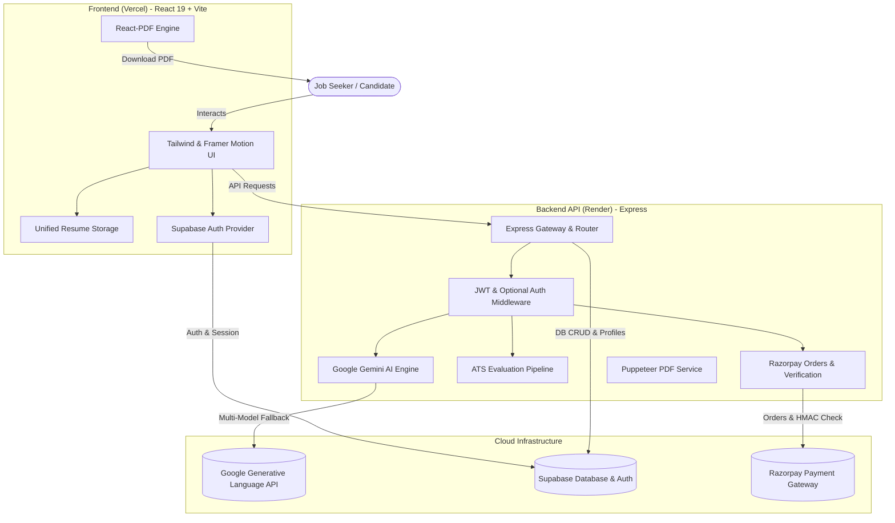

# ⚡ ResumeAI Pro — Next-Gen AI Resume & Career Intelligence Platform

<div align="center">

[](https://react.dev/)
[](https://vitejs.dev/)
[](https://nodejs.org/)
[](https://expressjs.com/)
[](https://supabase.com/)
[](https://ai.google.dev/)
[](https://razorpay.com/)
[](https://tailwindcss.com/)
[](https://resumeaihritik.vercel.app)

**Transform raw career history into high-converting, ATS-beating resumes, cover letters, and recruiter insights powered by Google Gemini AI.**

[🌐 Live Production Website](https://resumeaihritik.vercel.app) • [📖 Documentation](#-table-of-contents) • [🚀 Quickstart](#-quickstart--installation)

</div>

---

## 📑 Table of Contents

- [Overview](#-overview)
- [Key Features](#-key-features)
  - [1. Intelligent AI Resume Builder](#1-intelligent-ai-resume-builder)
  - [2. Gemini AI ATS Recruiter Scanner](#2-gemini-ai-ats-recruiter-scanner)
  - [3. AI Cover Letter Generator](#3-ai-cover-letter-generator)
  - [4. Seamless Subscriptions & Payments](#4-seamless-subscriptions--payments)
  - [5. Hardened Security & Auth](#5-hardened-security--auth)
  - [6. Admin & Analytics Dashboard](#6-admin--analytics-dashboard)
- [System Architecture](#-system-architecture)
- [Tech Stack](#-tech-stack)
- [Project Directory Structure](#-project-directory-structure)
- [Quickstart & Installation](#-quickstart--installation)
  - [Prerequisites](#prerequisites)
  - [Frontend Setup](#1-frontend-setup)
  - [Backend Setup](#2-backend-setup)
- [Environment Variables Guide](#-environment-variables-guide)
- [Database Schema (Supabase)](#-database-schema-supabase)
- [API Reference](#-api-reference)
- [Deployment Guide](#-deployment-guide)
- [Contributing & License](#-contributing--license)

---

## 🌟 Overview

**ResumeAI Pro** is a full-stack, enterprise-grade AI career suite designed for modern job seekers. Unlike basic resume editors, ResumeAI Pro combines **Google Gemini generative intelligence** with **real-time ATS parsing (PDF.js)**, **deterministic fallback engines**, and **instant high-resolution client-side & server-side PDF exports**.

Whether optimizing bullet points using the Google STAR method, generating tailor-made cover letters for target job postings, or performing comprehensive ATS audits with recruiter feedback, ResumeAI Pro delivers end-to-end career intelligence.

---

## 🚀 Key Features

### 1. Intelligent AI Resume Builder
- **Multi-Layout Aesthetic Templates:** Modern, Minimalist, Tech Executive, Classic Professional, and Creative layouts with custom color palettes and typography.
- **AI Bullet Point Polish:** Turn weak experience points into quantifiable accomplishments with metric-focused action verbs (*STAR method: Situation, Task, Action, Result*).
- **Executive Summary Generator:** Produces compelling 3-4 sentence professional summaries tailored to specific target job titles.
- **Real-Time Autosave & Local-First Sync:** Zero-latency updates with local storage caching backed by Supabase cloud synchronization.
- **Instant High-Res PDF Export:** Built with `@react-pdf/renderer` and Puppeteer backend fallback for pristine, single/multi-page print-ready documents.

### 2. Gemini AI ATS Recruiter Scanner
- **Direct PDF Upload & Parse:** Uses `pdfjs-dist` to parse uploaded resume PDFs directly in the browser.
- **Recruiter Assessment Engine:** Powered by Google Gemini (`gemini-3.6-flash`, `gemini-3.1-flash-lite`) to grade resumes on a 0–100 ATS scoring scale.
- **7-Dimensional Breakdown:**
  - Contact Information Integrity
  - Professional Summary Impact
  - Work Experience & Metrics
  - Skills Relevance & Keyword Density
  - Education & Certifications
  - ATS Formatting & Parser Compatibility
  - Target Job Description Match Percentage
- **Missing Keywords Extraction:** Pinpoints high-priority industry skills and keywords absent from the candidate's resume.

### 3. AI Cover Letter Generator
- **Role-Specific Generation:** Enter job title, company name, and job description to produce cohesive, targeted cover letters.
- **Voice & Tone Selection:** Choose between Professional, Enthusiastic, Confident, and Direct styles.
- **One-Click Clipboard & Download:** Copy cleanly formatted text or export as standard document formats.

### 4. Seamless Subscriptions & Payments
- **Tiered Plans:** *Free*, *Starter*, *Pro*, and *Enterprise* tiers with feature gating and usage limits.
- **Razorpay Integration:** Full test and live mode support with cryptographic HMAC-SHA256 signature verification.
- **Instant Role Upgrade:** Automatic profile privilege elevation and receipt generation upon payment confirmation.

### 5. Hardened Security & Auth
- **Supabase Authentication:** Secure JWT-based auth supporting email/password, magic links, OTP codes, and password recovery.
- **Branded Transactional Emails:** Handcrafted dark-mode responsive email templates for signup confirmation, invite, password reset, and re-authentication.
- **Rate-Limiting & Helmet:** Backend API protected by `express-rate-limit`, `helmet` HTTP headers, and strict CORS whitelisting.

### 6. Admin & Analytics Dashboard
- **Live System Metrics:** Total registered candidates, active subscriptions, platform revenue, and generated resume counts.
- **User Management:** Search, view plan status, upgrade/downgrade tiers, and audit platform usage.

---

## 🏗 System Architecture



---

## 💻 Tech Stack

| Layer | Technologies |
| :--- | :--- |
| **Frontend** | React 19, Vite 8, Tailwind CSS, Framer Motion, Radix UI Primitives, Lucide Icons |
| **PDF Processing** | `@react-pdf/renderer`, `pdfjs-dist`, Puppeteer |
| **Backend API** | Node.js (v18+), Express 4.19, Helmet, CORS, Morgan, Express-Rate-Limit |
| **AI / LLM** | Google Gemini Generative AI (`gemini-3.6-flash`, `gemini-3.1-flash-lite`, `gemini-flash-latest`) |
| **Database & Auth** | Supabase (PostgreSQL with RLS, Supabase Auth SDK, Service Role Admin) |
| **Payments** | Razorpay Node.js SDK with HMAC-SHA256 signature verification |
| **Deployment** | Frontend on **Vercel**, Backend on **Render**, DB on **Supabase Cloud** |

---

## 📁 Project Directory Structure

```text
resumeai-pro/
├── index.html                   # HTML entry point with SEO meta tags
├── package.json                 # Frontend dependencies and Vite scripts
├── vite.config.js               # Vite configuration and plugins
├── tailwind.config.js           # Tailwind design tokens & font settings
│
├── src/                         # Frontend Application Source
│   ├── main.jsx                 # React root mounting
│   ├── App.jsx                  # Router configuration and layout wrapper
│   ├── components/              # Reusable UI & Layout Components
│   │   ├── layout/              # Navbar, Footer, AppLayout
│   │   ├── resume/              # Resume templates (Modern, Tech, Minimal)
│   │   └── ui/                  # Radix buttons, modals, badges, inputs
│   ├── context/                 # AuthContext & Plan State Provider
│   ├── lib/                     # API client (Axios), AI Service, Supabase client
│   ├── pages/                   # Main Application Views
│   │   ├── Home.jsx             # High-converting landing page
│   │   ├── Builder.jsx          # Interactive AI Resume Builder
│   │   ├── AtsChecker.jsx       # AI-Powered ATS Scanner & Scoring
│   │   ├── CoverLetter.jsx      # AI Cover Letter Generator
│   │   ├── Pricing.jsx          # Plan comparison & Razorpay checkout
│   │   ├── Dashboard.jsx        # Candidate resume dashboard
│   │   ├── Admin.jsx            # Platform management dashboard
│   │   └── ResetPassword.jsx    # Token-aware password reset page
│   └── templates/               # Resume PDF & DOM print templates
│
├── server/                      # Express Backend API
│   ├── index.js                 # Server entry point, middleware, rate limiter
│   ├── package.json             # Backend dependencies
│   ├── config/                  # Plan tiers, pricing, and limits
│   ├── lib/                     # Core backend services
│   │   ├── gemini.js            # Resilient multi-model Gemini client & JSON parser
│   │   ├── supabase.js          # Supabase Admin client
│   │   ├── razorpay.js          # Razorpay payment helpers
│   │   └── mailer.js            # Transactional email dispatcher
│   ├── middleware/              # requireAuth, optionalAuth, adminAuth
│   └── routes/                  # Modular REST API routes
│       ├── ai.js                # AI summary, bullets, cover letter endpoints
│       ├── ats.js               # ATS analysis & Gemini scoring endpoints
│       ├── auth.js              # Auth helper & password recovery
│       ├── payment.js           # Order creation & signature verification
│       ├── resumes.js           # Cloud resume CRUD & storage
│       └── admin.js             # Platform metrics & user moderation
│
└── supabase/                    # Database & Email Configuration
    ├── migrations/              # Initial SQL schemas, profiles, and RLS policies
    └── email-templates/         # Production-ready custom HTML email templates
        ├── confirm-signup.html
        ├── invite-user.html
        ├── magic-link.html
        ├── change-email.html
        ├── reset-password.html
        └── reauthentication.html
```

---

## ⚡ Quickstart & Installation

### Prerequisites
- **Node.js**: v18.0.0 or higher
- **npm** or **pnpm**
- **Supabase Account**: For PostgreSQL database and authentication
- **Google AI Studio API Key**: For Gemini AI features
- **Razorpay Account**: For payment processing (Test mode key/secret)

---

### 1. Frontend Setup

1. **Clone repository and navigate to root directory:**
   ```bash
   git clone https://github.com/hritikkumarpd/resumeai-pro.git
   cd resumeai-pro
   ```

2. **Install frontend dependencies:**
   ```bash
   npm install
   ```

3. **Configure environment variables:**
   Create `.env` in the root directory:
   ```env
   VITE_APP_NAME="ResumeAI Pro"
   VITE_SUPABASE_URL="https://your-supabase-project.supabase.co"
   VITE_SUPABASE_ANON_KEY="your-supabase-anon-key"
   VITE_API_URL="http://localhost:5000/api"
   VITE_RAZORPAY_KEY_ID="rzp_test_your_key_id"
   ```

4. **Launch development server:**
   ```bash
   npm run dev
   ```
   *Frontend will be running at:* `http://localhost:5173`

---

### 2. Backend Setup

1. **Navigate to the server directory:**
   ```bash
   cd server
   ```

2. **Install backend dependencies:**
   ```bash
   npm install
   ```

3. **Configure server environment variables:**
   Create `server/.env`:
   ```env
   PORT=5000
   NODE_ENV=development
   FRONTEND_URL=http://localhost:5173

   # Google Gemini AI
   GEMINI_API_KEY=your_google_gemini_api_key

   # Supabase Admin
   SUPABASE_URL=https://your-supabase-project.supabase.co
   SUPABASE_SERVICE_ROLE_KEY=your_supabase_service_role_key

   # Razorpay Payment Gateway
   RAZORPAY_KEY_ID=rzp_test_your_key_id
   RAZORPAY_KEY_SECRET=your_razorpay_key_secret

   # Security Secrets
   JWT_SECRET=your_jwt_signing_secret_min_32_chars
   ADMIN_SECRET=your_secure_admin_passphrase
   ```

4. **Start backend API:**
   ```bash
   npm run dev
   ```
   *API will be listening at:* `http://localhost:5000`

---

## 🔐 Environment Variables Guide

| Variable | Scope | Description |
| :--- | :--- | :--- |
| `VITE_SUPABASE_URL` | Frontend | Supabase project API URL |
| `VITE_SUPABASE_ANON_KEY` | Frontend | Public anonymous Supabase key |
| `VITE_API_URL` | Frontend | URL of backend API (`/api`) |
| `VITE_RAZORPAY_KEY_ID` | Frontend | Public Razorpay Key ID |
| `GEMINI_API_KEY` | Backend | Google AI Studio API key (kept secure on server) |
| `SUPABASE_SERVICE_ROLE_KEY` | Backend | Elevated service key to bypass RLS for administrative tasks |
| `RAZORPAY_KEY_SECRET` | Backend | Secret used to verify HMAC-SHA256 payment signatures |
| `FRONTEND_URL` | Backend | Origin for password reset redirects & CORS validation |
| `ADMIN_SECRET` | Backend | Secret header value required for accessing `/api/admin` |

---

## 🗄 Database Schema (Supabase)

Run the migration scripts located in [`supabase/migrations/`](file:///supabase/migrations) in your Supabase SQL Editor:

```sql
-- Profiles table for user metadata & subscriptions
CREATE TABLE IF NOT EXISTS public.profiles (
  id UUID REFERENCES auth.users(id) ON DELETE CASCADE PRIMARY KEY,
  email TEXT NOT NULL,
  full_name TEXT,
  avatar_url TEXT,
  plan TEXT DEFAULT 'free' CHECK (plan IN ('free', 'starter', 'pro', 'enterprise')),
  resume_count INTEGER DEFAULT 0,
  created_at TIMESTAMPTZ DEFAULT NOW(),
  updated_at TIMESTAMPTZ DEFAULT NOW()
);

-- Payments log for verified transactions
CREATE TABLE IF NOT EXISTS public.payments (
  id UUID DEFAULT gen_random_uuid() PRIMARY KEY,
  user_id UUID REFERENCES auth.users(id) ON DELETE CASCADE,
  order_id TEXT NOT NULL,
  payment_id TEXT NOT NULL,
  amount NUMERIC NOT NULL,
  currency TEXT DEFAULT 'INR',
  plan TEXT NOT NULL,
  status TEXT DEFAULT 'success',
  created_at TIMESTAMPTZ DEFAULT NOW()
);

-- Resumes table for cloud synchronization
CREATE TABLE IF NOT EXISTS public.resumes (
  id UUID DEFAULT gen_random_uuid() PRIMARY KEY,
  user_id UUID REFERENCES auth.users(id) ON DELETE CASCADE,
  title TEXT DEFAULT 'Untitled Resume',
  template TEXT DEFAULT 'modern',
  data JSONB NOT NULL DEFAULT '{}'::jsonb,
  is_public BOOLEAN DEFAULT false,
  created_at TIMESTAMPTZ DEFAULT NOW(),
  updated_at TIMESTAMPTZ DEFAULT NOW()
);
```

---

## 📡 API Reference

### AI Endpoints (`/api/ai`)
| Method | Route | Description |
| :--- | :--- | :--- |
| `POST` | `/api/ai/enhance` | Enhances summary or bullet points using Gemini AI |
| `POST` | `/api/ai/cover-letter` | Generates a tailored, professional cover letter |
| `POST` | `/api/ai/suggest-skills` | Analyzes work experience and suggests relevant skills |

### ATS Endpoints (`/api/ats`)
| Method | Route | Description |
| :--- | :--- | :--- |
| `POST` | `/api/ats/analyze` | Generates a comprehensive 0-100 ATS score and recruiter audit |

### Payment Endpoints (`/api/payment`)
| Method | Route | Description |
| :--- | :--- | :--- |
| `POST` | `/api/payment/create-order` | Initializes a Razorpay order for subscription checkout |
| `POST` | `/api/payment/verify` | Validates HMAC-SHA256 payment signature & upgrades user |

### Auth Endpoints (`/api/auth`)
| Method | Route | Description |
| :--- | :--- | :--- |
| `POST` | `/api/auth/forgot-password` | Initiates password reset email with verified redirect |
| `POST` | `/api/auth/reset-password` | Updates user password with authenticated session |

---

## 🌐 Deployment Guide

### Deploying Frontend to Vercel
1. Link your GitHub repository to Vercel.
2. Framework Preset: **Vite**.
3. Add Environment Variables:
   - `VITE_SUPABASE_URL`
   - `VITE_SUPABASE_ANON_KEY`
   - `VITE_API_URL` (Set to your live Render backend URL, e.g. `https://resumeai-pro-api.onrender.com/api`)
   - `VITE_RAZORPAY_KEY_ID`

### Deploying Backend to Render
1. Create a **Web Service** on Render connected to the repository.
2. Root Directory: `server`.
3. Build Command: `npm install`.
4. Start Command: `node index.js`.
5. Add Environment Variables:
   - `GEMINI_API_KEY`
   - `SUPABASE_URL`
   - `SUPABASE_SERVICE_ROLE_KEY`
   - `RAZORPAY_KEY_ID` & `RAZORPAY_KEY_SECRET`
   - `FRONTEND_URL` (`https://resumeaihritik.vercel.app`)

---

## 📄 License & Author

Crafted with ❤️ by **Hritik Kumar**

Distributed under the **MIT License**. Feel free to use, modify, and distribute this software for personal and commercial projects.
